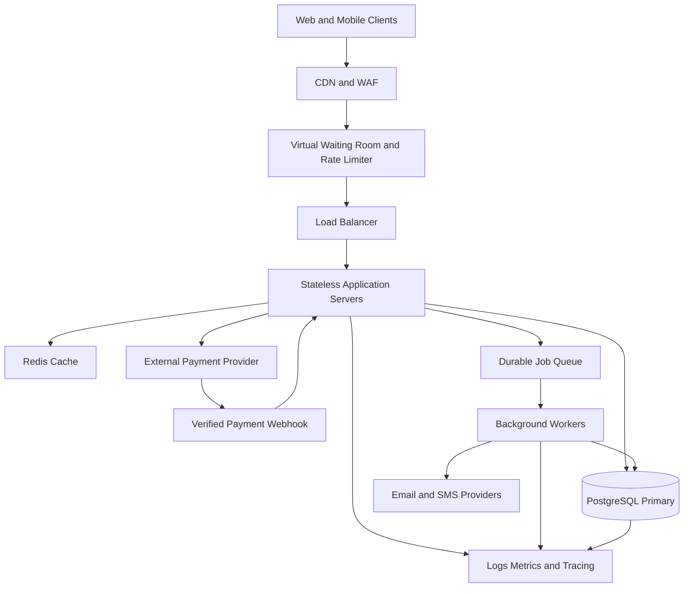

 TicketHub: Event Ticketing System Design

 1. Requirements

 Functional requirements

TicketHub allows customers to discover events, select seats, pay for tickets, and access their purchased tickets.

The system must:

1. Allow users to register, sign in, and manage their accounts.
2. Display events with dates, venues, descriptions, prices, and available seats.
3. Allow customers to view a seating plan and select available seats.
4. Temporarily hold selected seats while a customer completes checkout.
5. Process payments through a payment provider.
6. Confirm successful orders and issue unique digital tickets.
7. Send order confirmations by email or SMS.
8. Allow customers to view their tickets and order history.
9. Allow event administrators to create events, configure seats, set prices, and monitor sales.
10. Prevent duplicate seat sales, duplicate payment processing, and purchases that exceed configured limits.

 Non-functional requirements

- Consistency: A seat must never be sold to two customers for the same event.
-Availability: Event browsing should remain available during periods of heavy traffic. Checkout may temporarily reject or queue requests when necessary to protect data integrity.
- Scalability: The application must scale horizontally to handle sudden increases in visitors.
- Performance: Event details and seat availability should load quickly under normal conditions.
- Security: Use HTTPS, secure authentication, authorization, rate limiting, and validated payment-provider webhooks. Never store raw payment-card details.
- Reliability: Recover safely from failed payments, application crashes, network timeouts, and duplicated requests.
- Fairness: Apply a transparent waiting-room policy, bot protection, and per-user purchase limits during popular sales.
- Observability: Record application errors, payment failures, queue lengths, response times, and seat-hold conflicts without exposing sensitive information.

 Scope and assumptions

TicketHub supports multiple events, each with its own venue, seats, prices, and orders. A customer can buy one or more seats, subject to event-specific limits.

The system uses a relational database as the authoritative source for seat ownership and order status. A cache can accelerate event browsing, but cached seat information cannot authorize a purchase.

 2. Traffic and capacity estimates

 Given information

- Registered users: 2,000,000
- Normal-day visitors: 50,000
- Average pages viewed per visitor: 10
- Normal ticket sales: 5,000 per day
- Popular sale: 200,000 people attempting to buy 20,000 seats in 10 minutes

 Normal-day traffic

Daily page views

50,000 visitors × 10 page views = 500,000 page views per day.

Average page views per second

500,000 ÷ 86,400 seconds ≈ 5.8 page views per second.

This is only a daily average. Actual traffic may be much higher during announcements, event launches, and ticket releases.

Daily ticket sales

The system processes approximately 5,000 ticket sales per day. This does not mean there are exactly 5,000 orders because an order can contain multiple tickets.

 Popular-sale traffic

Average number of buyer attempts per second

200,000 ÷ 600 seconds ≈ **333 buyer attempts per second**.

Seat demand

20,000 seats are available for 200,000 interested people. If each person wants one seat, only 10% of the interested people could obtain a seat.

Estimated API request load

For capacity planning, assume each buyer makes five API requests during the sale, including requests to view event information, inspect seats, create a hold, and complete checkout.

- Total API requests: 200,000 × 5 = 1,000,000 requests.
- Average request rate over 10 minutes: 1,000,000 ÷ 600 ≈ 1,667 requests per second.
- If peak traffic reaches three to five times that average, the system should be tested for approximately 5,000–8,500 requests per second.

These are planning assumptions, not measured production traffic. Monitoring and load testing would be needed to validate them.

Capacity strategy

1. Serve static files and public event information through a CDN and cache.
2. Use a virtual waiting room to control admission during high-demand sales.
3. Scale stateless application servers horizontally.
4. Rate-limit abusive clients and apply per-account purchase limits.
5. Use a durable relational database for seat reservations and orders.
6. Use background workers for email, SMS, ticket generation, and other tasks that do not need to block checkout.
7. Run load tests that simulate bursts, abandoned checkouts, payment delays, and database contention.

 3. API design

The API uses versioned REST endpoints and JSON responses. Authenticated endpoints require a valid access token, and all sensitive operations enforce authorization.

| Method and endpoint | Purpose |
|---|---|
| `GET /api/v1/events` | List events, with optional date, category, and pagination filters. |
| `GET /api/v1/events/{eventId}` | Retrieve event details, venue, and pricing information. |
| `GET /api/v1/events/{eventId}/seats` | Display the seating plan and current seat availability. |
| `POST /api/v1/events/{eventId}/holds` | Atomically reserve selected seats for a short period. |
| `DELETE /api/v1/holds/{holdId}` | Release a customer's active seat hold. |
| `POST /api/v1/orders` | Create an order from a valid hold. |
| `POST /api/v1/orders/{orderId}/payments` | Initiate payment through the payment provider. |
| `POST /api/v1/payments/webhook` | Receive and verify payment-provider notifications. |
| `GET /api/v1/me/tickets` | List the authenticated customer's tickets. |

Example: creating a seat hold

Request:

```http
POST /api/v1/events/evt_101/holds
Authorization: Bearer <access-token>
Idempotency-Key: 8b6d4c-example
Content-Type: application/json
```

```json
{
  "seatIds": ["A-10", "A-11"]
}
```

A successful response could be:

```json
{
  "holdId": "hold_501",
  "status": "held",
  "expiresAt": "2026-10-27T19:35:00Z",
  "seatIds": ["A-10", "A-11"]
}
```

The expiry timestamp is illustrative. In production, the server generates the actual expiry time.

If either requested seat is unavailable, the system should reject the reservation without leaving the customer with a misleading partial hold. A conflict response, such as HTTP `409 Conflict`, tells the client to refresh availability and select other seats.

API safety rules

- Use idempotency keys for operations that may be retried, especially order creation and payment initiation.
- Verify payment webhook signatures and process each provider event idempotently.
- Never trust a price supplied by the browser; calculate prices on the server.
- Return appropriate errors for expired holds, unavailable seats, invalid requests, and unauthorized access.
- Protect endpoints against excessive requests and enforce purchase limits on the server.

4. Data model

TicketHub uses a relational database such as PostgreSQL because seat ownership, orders, and payments require reliable transactions and constraints.

 Main tables

| Table | Important columns | Purpose |
|---|---|---|
| `users` | `id`, `email`, `password_hash`, `created_at` | Stores customer accounts. |
| `events` | `id`, `title`, `venue`, `starts_at`, `status` | Stores event information. |
| `seats` | `id`, `event_id`, `seat_number`, `price`, `status`, `hold_expires_at`, `held_by_user_id` | Tracks each seat for an event. |
| `seat_holds` | `id`, `user_id`, `event_id`, `expires_at`, `status` | Records temporary reservations. |
| `orders` | `id`, `user_id`, `status`, `total_amount`, `created_at` | Tracks checkout and order status. |
| `order_items` | `id`, `order_id`, `seat_id`, `price_at_purchase` | Associates purchased seats with orders. |
| `payments` | `id`, `order_id`, `provider_reference`, `amount`, `status` | Tracks payment attempts and results. |
| `tickets` | `id`, `order_item_id`, `ticket_code`, `status` | Stores issued digital tickets. |

 Relationships

- One user can create many orders and seat holds.
- One event has many seats.
- One seat can have multiple historical hold attempts, but only one active hold at a time.
- One order contains one or more order items.
- Each order item refers to one seat and records its purchase price.
- An order can have multiple payment attempts, but only one successful payment should fulfil the same order.
- A paid order item can produce one ticket.

The database should enforce appropriate foreign keys, unique constraints, and checks. For example, `(event_id, seat_number)` must be unique, and `ticket_code` must be unique. The application must also enforce that a seat cannot belong to two completed sales.

How TicketHub prevents two customers from buying the same seat

The database transaction is the source of truth—not the browser, cache, or displayed seating plan.

1. A customer requests a hold for a seat.
2. The server starts a database transaction and locks the relevant seat row, or uses an atomic conditional update.
3. The server changes the seat from `available` to `held` only if it is available or its previous hold has expired.
4. The transaction records the hold owner and expiry time, then commits.
5. If another customer requests the same seat at the same time, their operation must wait for the lock or fail the conditional update. It cannot successfully claim a seat already held by someone else.
6. Only the customer with the valid hold can proceed to checkout for that seat.
7. After verified payment, the server confirms the order and changes the seat to `sold` in a transaction, checking that the hold belongs to that customer and is still valid.
8. Expired or abandoned holds are released so other customers can reserve those seats.

The database operation must check the seat's current state when updating it. For example, an atomic update can change a seat to `held` only when its status is `available`; the application then checks that exactly one row was updated. Expired holds must be reclaimed safely under the same locking or conditional-update rules.

Payment happens outside the database transaction because an external payment provider may take several seconds to respond. The seat remains held while checkout is active. A verified payment webhook completes the order using an idempotent transaction. If payment fails or the hold expires, the system follows a defined recovery process, including checking payment status before releasing a seat that may have been paid for.

Unique constraints, transactional locking, hold expiry, idempotent payment processing, and reconciliation jobs work together to prevent duplicate sales and recover from failures.

 5. System architecture

 High-level architecture diagram



 Component responsibilities

Web and mobile clients: Let users browse events, choose seats, pay, and retrieve tickets. The client displays availability but never makes the final decision about whether a seat is available.

CDN and web application firewall (WAF): Deliver static assets close to users, reduce origin traffic, and filter common malicious requests.

Virtual waiting room and rate limiter: Manage demand during major sales. A transparent queue policy, signed queue tokens, bot protection, and account-level limits reduce overload and automated abuse.

Load balancer and application servers: Distribute requests across multiple stateless server instances. Instances can scale horizontally, and failed instances can be removed without losing authoritative order data.

Redis cache: Speeds up event descriptions, venue details, and other frequently read data. Seat availability shown from a cache may be stale, so all seat holds and purchases must be verified against the database.

PostgreSQL: Stores users, events, seats, holds, orders, payments, and tickets. Transactions, row locking, and constraints protect the correctness of seat allocation and order completion.

Durable job queue and background workers: Handle email, SMS, ticket generation, and reconciliation tasks asynchronously. Failed jobs can be retried without losing the original request.

Payment provider: Processes payments without TicketHub storing raw card details. Signed webhooks and provider-side status checks help the system handle delayed or repeated payment notifications safely.

Monitoring and logging: Track request rates, queue depth, database contention, seat-hold conflicts, payment failures, and checkout latency. Alerts help operators respond before the service becomes unavailable.

Purchase flow

1. The customer joins the waiting room if the sale is under heavy load.
2. The customer browses the event and selects seats.
3. The server atomically creates a temporary hold for the selected seats.
4. The customer confirms checkout, and TicketHub creates an order with a pending payment status.
5. TicketHub requests payment from the external provider.
6. After receiving and verifying a successful payment notification, TicketHub completes the order, marks the seats sold, and makes the tickets available.
7. Background workers send the confirmation and ticket details.

If a payment notification is delayed, the order remains pending until the provider's status can be verified. Retries must not create duplicate orders, charge customers twice, or issue duplicate tickets.

 6. Design trade-offs

 Trade-off 1: Strong consistency versus high availability

A relational database transaction and seat lock prevent two customers from claiming the same seat. However, simultaneous requests for a popular seat may wait or receive a conflict response.

Decision: Prioritize correct seat ownership over accepting every checkout request immediately. Queue or reject competing requests and ask customers to choose another seat. Event browsing can remain more available because it does not make the final reservation decision.

 Trade-off 2: Cache performance versus fresh availability

Caching event and seat information reduces database load, but cached availability can become outdated when another customer reserves a seat.

Decision: Cache relatively stable event information aggressively. Treat seat availability as advisory and validate every hold and purchase against PostgreSQL.

 Trade-off 3: Waiting-room fairness versus checkout speed

A waiting room protects the application from traffic spikes and can reduce advantages gained through rapid automated requests. However, it adds another component and can increase waiting time.

Decision: Use a transparent, monitored queue during high-demand sales, with clear rules and protections against bots. Design the queue to fail safely rather than allowing an uncontrolled traffic surge to overwhelm checkout.

 Trade-off 4: Short holds versus customer convenience

Short holds allow abandoned seats to return to inventory quickly but may frustrate customers who need more time to complete payment. Long holds improve convenience but reduce the seats available to others.

Decision: Use a configurable hold duration, show a clear countdown, and release expired holds reliably. Handle delayed payment confirmations carefully so that a genuinely paid order is reconciled rather than blindly releasing its seat.

 Conclusion

TicketHub must support ordinary browsing and sudden, intense demand while preserving the correctness of seat ownership and payments. Horizontal scaling, a controlled waiting room, caching, asynchronous workers, and database transactions address different parts of the problem. The most important rule is that only an atomic, validated database operation can grant a seat hold or complete a sale. This protects customers from duplicate bookings even when many requests arrive simultaneously.