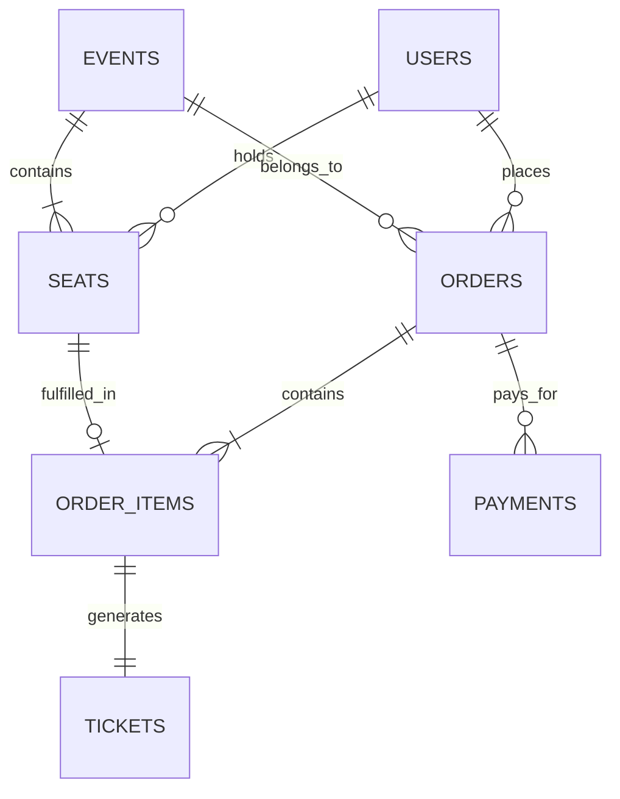
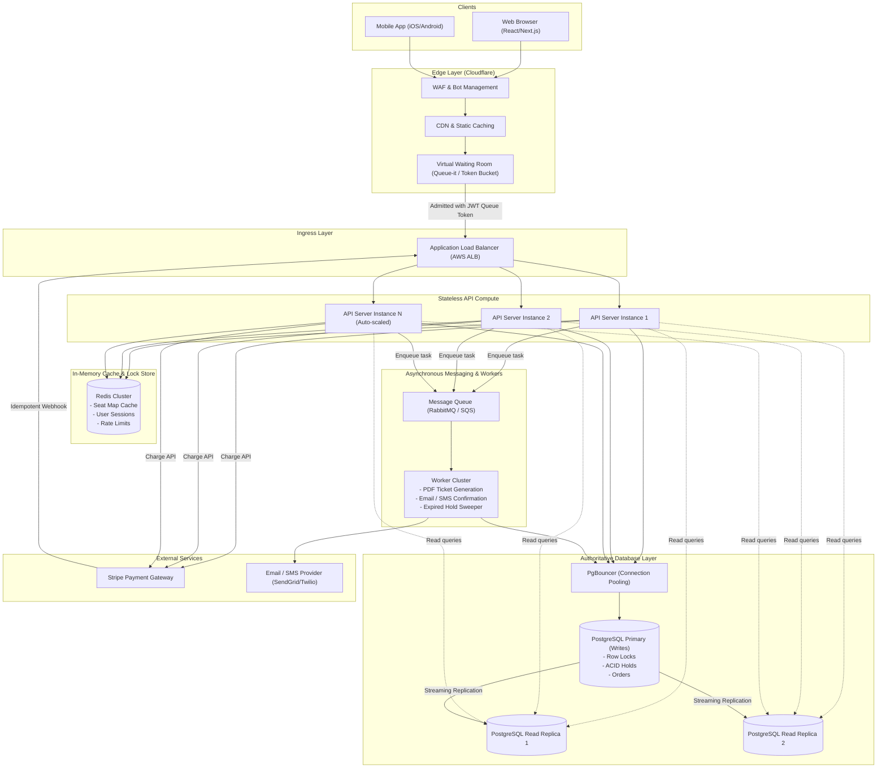

# TicketHub: Event Ticketing System Design

## 1. Requirements

TicketHub is a high-concurrency event ticketing platform that allows users to discover concerts, reserve specific seats in real time, purchase tickets securely, and access digital passes.

### Functional Requirements

1. **User Accounts & Authentication:** Users can register, log in, manage their profile, and authenticate via secure sessions or JWT tokens.
2. **Event & Venue Browsing:** Users can search and filter events by artist, date, venue, city, and category, and view detailed venue information.
3. **Interactive Seating Plan:** Users can view venue seating charts with real-time seat availability (available, held, sold) and tier pricing.
4. **Temporary Seat Holds:** Users can select available seats and hold them for a limited window (10 minutes) to complete payment without another user purchasing them.
5. **Secure Payment Processing:** Users can pay for held tickets via credit card, mobile payment, or external payment gateways (e.g., Stripe) using idempotent payment tokens.
6. **Ticket Issuance & Delivery:** Upon successful payment, the system issues unique digital tickets with verifiable QR codes and sends email/SMS confirmations.
7. **Ticket Management:** Users can view their active tickets, past orders, and download PDF tickets from their profile.
8. **Admin Operations:** Event organizers can create events, configure seating manifests, set pricing tiers, and monitor live sales.

### Non-Functional Requirements

* **Speed (Performance & Latency):**
  * Event search and catalog pages must load in under 200 ms at the 95th percentile ($P_{95}$).
  * Seat availability queries and hold requests must complete in under 100 ms ($P_{99}$) under normal conditions and under 500 ms during high-traffic on-sale events.
* **Correctness (Data Integrity & Zero Double-Booking):**
  * **Strict zero double-booking:** Under no circumstances may the same seat for the same event be sold or held concurrently by more than one customer.
  * ACID transaction compliance for all seat state transitions and monetary operations.
  * Payment and order processing must be idempotent: network timeouts or user retries must never cause duplicate credit card charges or duplicate ticket issuance.
* **Fairness (Equal Access & Anti-Abuse):**
  * A virtual waiting room mechanism ensures first-in, first-out (FIFO) or fair randomized batch admission during peak sales.
  * Per-user purchase caps (e.g., maximum 4 to 6 tickets per event per account/credit card) prevent ticket hoarding.
  * Rate limiting, CAPTCHA, and Web Application Firewall (WAF) bot filtering mitigate scalper bots and automated scraping.
* **Availability & Fault Tolerance:**
  * 99.99% uptime for browsing and ticket retrieval.
  * Graceful degradation during peak demand: if database write limits are approached, the system uses admission queueing rather than crashing or returning generic 500 Internal Server Errors.
* **Security & Compliance:**
  * Full PCI-DSS compliance: sensitive payment details (PAN, CVV) are tokenized directly through the payment gateway and never touch TicketHub application servers or databases.
  * End-to-end TLS encryption (HTTPS), parameterized database queries to eliminate SQL injection, and cryptographically signed webhook validation.

---

## 2. Traffic and Capacity Estimates

### Given Facts

* **Registered users:** 2,000,000
* **Normal-day visitors:** 50,000 unique visitors
* **Average pages viewed per visitor:** 10 pages
* **Normal-day ticket sales:** 5,000 tickets sold per day
* **Popular concert on-sale:** 200,000 people attempt to buy 20,000 seats within the first 10 minutes (600 seconds)

---

### Normal-Day Traffic Calculations

1. **Total Daily Page Views:**
   $$\text{Daily Page Views} = 50{,}000 \times 10 = 500{,}000 \text{ views/day}$$

2. **Average Request Rate (Read RPS):**
   $$\text{Average RPS} = \frac{500{,}000 \text{ requests}}{86{,}400 \text{ seconds}} \approx 5.79 \text{ requests/second}$$

3. **Peak Normal Request Rate:**
   Assuming normal daily traffic follows a standard diurnality curve where peak hours account for 3× the average rate:
   $$\text{Peak Normal RPS} \approx 5.79 \times 3 \approx 17.4 \text{ requests/second}$$

4. **Normal Ticket Purchase Rate (Write RPS):**
   $$\text{Average Sales Rate} = \frac{5{,}000 \text{ tickets}}{86{,}400 \text{ seconds}} \approx 0.058 \text{ sales/second (1 sale every } \sim 17 \text{ seconds)}$$
   $$\text{Peak Normal Sales Rate} \approx 0.058 \times 3 \approx 0.174 \text{ sales/second}$$

---

### Big Sale Peak Traffic Calculations

When a blockbuster concert goes on sale, 200,000 users arrive and compete for 20,000 seats within a 10-minute window ($10 \text{ minutes} = 600 \text{ seconds}$).

1. **Active Buyers Arrival Rate:**
   $$\text{Active Buyers per Second} = \frac{200{,}000 \text{ users}}{600 \text{ seconds}} \approx 333.3 \text{ buyers/second}$$

2. **Seat Contention Ratio:**
   $$\text{Demand Ratio} = \frac{200{,}000 \text{ interested buyers}}{20,000 \text{ available seats}} = 10 \text{ buyers per seat}$$
   *Only 10% of users will successfully purchase a seat; 90% will be turned away or encounter sold-out notifications.*

3. **Peak Sale API Request Volume:**
   During the on-sale window, each active user performs an estimated 10 interactive API requests:
   * 1 request to enter the queue / poll queue status.
   * 2 requests to load event details and seating map manifest.
   * 3 requests to refresh availability and click seat selections.
   * 2 requests to attempt seat holds (including potential retries if first pick was taken).
   * 1 request to submit payment/checkout details.
   * 1 request to poll order confirmation / view digital ticket.

   $$\text{Total Requests in 10 minutes} = 200{,}000 \times 10 = 2{,}000{,}000 \text{ requests}$$
   $$\text{Average On-Sale RPS} = \frac{2{,}000{,}000 \text{ requests}}{600 \text{ seconds}} \approx 3{,}333.3 \text{ requests/second}$$

4. **Instantaneous Peak Burst Rate:**
   At the exact opening second (e.g., 10:00:00 AM), user traffic surges in a stampede. Factoring in an initial 2.5× to 3× burst factor:
   $$\text{Peak Burst RPS} \approx 3{,}333 \times 2.5 \approx 8{,}333 \text{ to } 10{,}000 \text{ requests/second}$$

5. **Ticket Write Throughput:**
   * If all 20,000 seats are claimed and sold within the 10-minute window:
   $$\text{Average Successful Seat Writes} = \frac{20{,}000 \text{ seats}}{600 \text{ seconds}} \approx 33.3 \text{ sold seats/second}$$
   * Concurrently, hold attempts will arrive at up to $333 \text{ attempts/second}$, creating heavy row-level contention on remaining available seats.

---

### Traffic Comparison: Normal vs. Big Sale

| Metric | Normal Day | Big Sale (10-Minute Peak) | Scale Factor |
|---|---|---|---|
| **Active Users** | 50,000 across 24 hours | 200,000 concentrated in 10 minutes | **~576× user density** |
| **Total Requests** | 500,000 / day | 2,000,000 / 10 min | **4× total volume in 1/144th the time** |
| **Average Throughput** | ~5.8 RPS | ~3,333 RPS | **~575× increase** |
| **Peak Burst Rate** | ~17.4 RPS | ~8,300 – 10,000 RPS | **~500× increase** |
| **Seat Purchase Rate** | 0.058 seats/sec | 33.3 seats/sec | **~574× increase** |
| **Database Contention** | Near zero (seats rarely clash) | Extreme (10 users competing per seat) | **High conflict density** |

**Conclusion:** Normal traffic can comfortably be served by a single modest application server and database instance. However, the Big Sale represents a massive **575× traffic surge** with severe row-level database contention that will crash an unmitigated relational database without architectural protection (virtual waiting rooms, caching, connection pooling, and atomic locking).

---

## 3. API Design

The TicketHub REST API uses standard JSON formatting, HTTP status codes, versioned paths (`/api/v1`), and bearer token authorization.

### 1. Browse Events

Returns a paginated list of upcoming events with optional keyword, city, and category filters.

* **Method & Path:** `GET /api/v1/events`
* **Authentication:** Public
* **Query Parameters:**
  * `query` (string, optional): Search keyword (artist, tour title).
  * `city` (string, optional): Venue city filter.
  * `page` (integer, default: 1): Page index.
  * `limit` (integer, default: 20): Results per page (max 100).
* **Success Status:** `200 OK`
* **Response Body:**
  ```json
  {
    "page": 1,
    "limit": 20,
    "total": 142,
    "events": [
      {
        "id": "evt_98f7e2a1",
        "title": "Coldplay - Music of the Spheres Tour",
        "artist": "Coldplay",
        "venue": "Wembley Stadium",
        "city": "London",
        "startsAt": "2026-11-15T19:30:00Z",
        "doorsOpen": "2026-11-15T17:30:00Z",
        "status": "ON_SALE",
        "startingPriceCents": 7500
      }
    ]
  }
  ```

---

### 2. View Seats for an Event

Retrieves the interactive seating manifest for an event, including section, row, seat number, tier, price, and current availability status.

* **Method & Path:** `GET /api/v1/events/{eventId}/seats`
* **Authentication:** Public
* **Path Parameters:**
  * `eventId` (string, required): Unique event identifier.
* **Query Parameters:**
  * `section` (string, optional): Filter by venue section (e.g., `A`, `B`, `VIP`).
* **Success Status:** `200 OK`
* **Response Body:**
  ```json
  {
    "eventId": "evt_98f7e2a1",
    "totalSeats": 20000,
    "availableCount": 1450,
    "seats": [
      {
        "id": "seat_a1_01",
        "section": "A1",
        "row": "A",
        "seatNumber": "1",
        "tier": "VIP_FLOOR",
        "priceCents": 15000,
        "status": "AVAILABLE"
      },
      {
        "id": "seat_a1_02",
        "section": "A1",
        "row": "A",
        "seatNumber": "2",
        "tier": "VIP_FLOOR",
        "priceCents": 15000,
        "status": "HELD"
      }
    ]
  }
  ```
* **Error Statuses:**
  * `404 Not Found`: Event does not exist.

---

### 3. Hold Seats (Temporary Reservation)

Atomically holds one or more seats for 10 minutes to allow the customer to complete the checkout flow.

* **Method & Path:** `POST /api/v1/events/{eventId}/holds`
* **Authentication:** Required (`Bearer <jwt_token>`)
* **Headers:**
  * `Idempotency-Key` (UUID, required): Prevents duplicate holds on retries.
* **Path Parameters:**
  * `eventId` (string, required): Unique event identifier.
* **Request Body:**
  ```json
  {
    "seatIds": ["seat_a1_01", "seat_a1_02"]
  }
  ```
* **Success Status:** `201 Created`
* **Response Body:**
  ```json
  {
    "holdId": "hld_4a9b2c3d",
    "eventId": "evt_98f7e2a1",
    "userId": "usr_882910fa",
    "seatIds": ["seat_a1_01", "seat_a1_02"],
    "totalAmountCents": 30000,
    "heldAt": "2026-10-27T22:45:00Z",
    "expiresAt": "2026-10-27T22:55:00Z",
    "status": "ACTIVE"
  }
  ```
* **Error Statuses:**
  * `400 Bad Request`: Exceeds ticket limit (e.g., > 6 seats requested).
  * `409 Conflict`: One or more requested seats are already held or sold.
    ```json
    {
      "error": "SEAT_UNAVAILABLE",
      "message": "Seat seat_a1_01 is no longer available.",
      "unavailableSeatIds": ["seat_a1_01"]
    }
    ```
  * `429 Too Many Requests`: User exceeded hold request rate limit.

---

### 4. Pay for Order / Complete Checkout

Submits payment token for an existing hold and converts held seats into a confirmed order.

* **Method & Path:** `POST /api/v1/orders/{orderId}/payments`
* **Authentication:** Required (`Bearer <jwt_token>`)
* **Headers:**
  * `Idempotency-Key` (UUID, required): Guarantees the credit card is charged exactly once.
* **Path Parameters:**
  * `orderId` (string, required): Unique order ID linked to the active hold.
* **Request Body:**
  ```json
  {
    "paymentProviderToken": "tok_1N4k8x2eZvKYlo2C",
    "expectedAmountCents": 30000,
    "currency": "USD"
  }
  ```
* **Success Status:** `200 OK`
* **Response Body:**
  ```json
  {
    "orderId": "ord_55102a9b",
    "status": "PAID",
    "amountPaidCents": 30000,
    "currency": "USD",
    "paymentReference": "ch_3MvY8k2eZvKYlo2C01",
    "confirmedAt": "2026-10-27T22:48:32Z",
    "ticketCount": 2,
    "tickets": [
      {
        "ticketId": "tkt_001",
        "seatId": "seat_a1_01",
        "qrCodeUrl": "https://cdn.tickethub.com/tickets/qr/tkt_001.png"
      },
      {
        "ticketId": "tkt_002",
        "seatId": "seat_a1_02",
        "qrCodeUrl": "https://cdn.tickethub.com/tickets/qr/tkt_002.png"
      }
    ]
  }
  ```
* **Error Statuses:**
  * `400 Bad Request`: Amount mismatch or invalid payment token.
  * `402 Payment Required`: Card declined or insufficient funds.
  * `410 Gone`: Seat hold expired before payment was authorized.

---

### 5. View Your Tickets

Retrieves all active and historical tickets purchased by the authenticated user.

* **Method & Path:** `GET /api/v1/me/tickets`
* **Authentication:** Required (`Bearer <jwt_token>`)
* **Query Parameters:**
  * `filter` (string, optional: `UPCOMING`, `PAST`, `ALL`): Default `UPCOMING`.
* **Success Status:** `200 OK`
* **Response Body:**
  ```json
  {
    "userId": "usr_882910fa",
    "tickets": [
      {
        "ticketId": "tkt_001",
        "orderId": "ord_55102a9b",
        "event": {
          "id": "evt_98f7e2a1",
          "title": "Coldplay - Music of the Spheres Tour",
          "venue": "Wembley Stadium",
          "city": "London",
          "startsAt": "2026-11-15T19:30:00Z"
        },
        "seat": {
          "section": "A1",
          "row": "A",
          "seatNumber": "1",
          "tier": "VIP_FLOOR"
        },
        "ticketCode": "TH-WEMB-2026-981240",
        "status": "VALID",
        "qrCodeUrl": "https://cdn.tickethub.com/tickets/qr/tkt_001.png"
      }
    ]
  }
  ```

---

## 4. Data Model

TicketHub uses a relational database (**PostgreSQL**) because ticket inventory management requires strict ACID guarantees, row-level locking, foreign key integrity, and unique constraints to make double-booking mathematically impossible at the storage layer.

### Core Tables

#### 1. `users` Table
Stores customer accounts and authentication credentials.

```sql
CREATE TABLE users (
    id UUID PRIMARY KEY DEFAULT gen_random_uuid(),
    email VARCHAR(255) NOT NULL UNIQUE,
    password_hash VARCHAR(255) NOT NULL,
    full_name VARCHAR(150) NOT NULL,
    phone_number VARCHAR(30),
    created_at TIMESTAMP WITH TIME ZONE DEFAULT CURRENT_TIMESTAMP,
    updated_at TIMESTAMP WITH TIME ZONE DEFAULT CURRENT_TIMESTAMP
);

CREATE INDEX idx_users_email ON users(email);
```

#### 2. `events` Table
Stores concerts, venues, date schedules, and ticket sale status.

```sql
CREATE TABLE events (
    id UUID PRIMARY KEY DEFAULT gen_random_uuid(),
    title VARCHAR(255) NOT NULL,
    artist VARCHAR(255) NOT NULL,
    venue_name VARCHAR(255) NOT NULL,
    city VARCHAR(100) NOT NULL,
    starts_at TIMESTAMP WITH TIME ZONE NOT NULL,
    doors_open_at TIMESTAMP WITH TIME ZONE NOT NULL,
    status VARCHAR(30) NOT NULL DEFAULT 'DRAFT'
        CHECK (status IN ('DRAFT', 'ON_SALE', 'SOLD_OUT', 'COMPLETED', 'CANCELLED')),
    created_at TIMESTAMP WITH TIME ZONE DEFAULT CURRENT_TIMESTAMP
);

CREATE INDEX idx_events_status_starts ON events(status, starts_at);
CREATE INDEX idx_events_city ON events(city);
```

#### 3. `seats` Table
Represents individual inventory items within an event's seating manifest.

```sql
CREATE TABLE seats (
    id UUID PRIMARY KEY DEFAULT gen_random_uuid(),
    event_id UUID NOT NULL REFERENCES events(id) ON DELETE CASCADE,
    section VARCHAR(50) NOT NULL,
    row VARCHAR(20) NOT NULL,
    seat_number VARCHAR(20) NOT NULL,
    tier VARCHAR(50) NOT NULL,
    price_cents INTEGER NOT NULL CHECK (price_cents >= 0),
    status VARCHAR(30) NOT NULL DEFAULT 'AVAILABLE'
        CHECK (status IN ('AVAILABLE', 'HELD', 'SOLD')),
    held_by_user_id UUID REFERENCES users(id),
    hold_expires_at TIMESTAMP WITH TIME ZONE,
    version INTEGER NOT NULL DEFAULT 0,
    created_at TIMESTAMP WITH TIME ZONE DEFAULT CURRENT_TIMESTAMP,
    -- Unique constraint ensures no duplicate seat coordinates exist within an event
    CONSTRAINT uq_event_seat UNIQUE (event_id, section, row, seat_number)
);

CREATE INDEX idx_seats_event_status ON seats(event_id, status);
CREATE INDEX idx_seats_hold_expiry ON seats(hold_expires_at) WHERE status = 'HELD';
```

#### 4. `orders` Table
Tracks purchase transactions and checkout lifecycles.

```sql
CREATE TABLE orders (
    id UUID PRIMARY KEY DEFAULT gen_random_uuid(),
    user_id UUID NOT NULL REFERENCES users(id),
    event_id UUID NOT NULL REFERENCES events(id),
    status VARCHAR(30) NOT NULL DEFAULT 'PENDING'
        CHECK (status IN ('PENDING', 'PAID', 'EXPIRED', 'CANCELLED', 'REFUNDED')),
    total_amount_cents INTEGER NOT NULL CHECK (total_amount_cents >= 0),
    currency VARCHAR(3) NOT NULL DEFAULT 'USD',
    idempotency_key UUID NOT NULL UNIQUE,
    created_at TIMESTAMP WITH TIME ZONE DEFAULT CURRENT_TIMESTAMP,
    updated_at TIMESTAMP WITH TIME ZONE DEFAULT CURRENT_TIMESTAMP
);

CREATE INDEX idx_orders_user ON orders(user_id);
```

#### 5. Supporting Tables (`order_items`, `payments`, `tickets`)

```sql
-- Links specific seats to an order
CREATE TABLE order_items (
    id UUID PRIMARY KEY DEFAULT gen_random_uuid(),
    order_id UUID NOT NULL REFERENCES orders(id) ON DELETE CASCADE,
    seat_id UUID NOT NULL REFERENCES seats(id),
    price_cents INTEGER NOT NULL,
    -- A seat can only belong to one non-cancelled order
    CONSTRAINT uq_order_seat UNIQUE (seat_id)
);

-- Records payment gateway transactions
CREATE TABLE payments (
    id UUID PRIMARY KEY DEFAULT gen_random_uuid(),
    order_id UUID NOT NULL REFERENCES orders(id),
    provider VARCHAR(50) NOT NULL DEFAULT 'STRIPE',
    provider_charge_id VARCHAR(255) NOT NULL UNIQUE,
    amount_cents INTEGER NOT NULL,
    currency VARCHAR(3) NOT NULL,
    status VARCHAR(30) NOT NULL CHECK (status IN ('SUCCESS', 'FAILED', 'PENDING')),
    created_at TIMESTAMP WITH TIME ZONE DEFAULT CURRENT_TIMESTAMP
);

-- Stores issued digital barcodes and ticket codes
CREATE TABLE tickets (
    id UUID PRIMARY KEY DEFAULT gen_random_uuid(),
    order_item_id UUID NOT NULL UNIQUE REFERENCES order_items(id),
    ticket_code VARCHAR(100) NOT NULL UNIQUE,
    status VARCHAR(30) NOT NULL DEFAULT 'ACTIVE'
        CHECK (status IN ('ACTIVE', 'USED', 'REVOKED')),
    qr_code_url VARCHAR(500) NOT NULL,
    issued_at TIMESTAMP WITH TIME ZONE DEFAULT CURRENT_TIMESTAMP
);
```

---

### Entity Relationships



* **Users to Orders (1:N):** A user can place many orders over time; each order belongs to one user.
* **Events to Seats (1:N):** An event has many fixed seats (e.g., 20,000); each seat belongs to exactly one event.
* **Orders to Order Items (1:N):** An order contains 1 to 6 order items (seats).
* **Seats to Order Items (1:1):** An individual seat can be associated with at most one active order item via the `uq_order_seat` constraint.
* **Orders to Payments (1:N):** An order may have multiple payment attempts, but only one successful payment transition.
* **Order Items to Tickets (1:1):** Each confirmed order item produces exactly one unique entry pass.

---

### Preventing Double-Booking: Transactions and Constraints

The central engineering challenge in an event ticketing platform is **preventing race conditions where two concurrent users attempt to buy the same seat at the exact same millisecond**.

#### 1. The Race Condition Problem
If User A and User B both view Seat `A-10` as `AVAILABLE`, both might submit a hold request simultaneously. If the application server executes a naive read-then-write:
```sql
-- DANGEROUS NAIVE APPROACH (DO NOT USE)
SELECT status FROM seats WHERE id = 'seat_a1_01'; -- Both return 'AVAILABLE'
-- Thread interleaving happens here!
UPDATE seats SET status = 'HELD' WHERE id = 'seat_a1_01'; -- Both succeed! (DOUBLE-BOOKING)
```

#### 2. The Solution: Atomic Conditional Update (Optimistic Locking)
TicketHub solves this using an atomic database statement that combines state checking, timestamp verification, and state transition into a single indivisible operation:

```sql
UPDATE seats
SET 
    status = 'HELD',
    held_by_user_id = $userId,
    hold_expires_at = NOW() + INTERVAL '10 minutes',
    version = version + 1
WHERE id = $seatId
  AND (
      status = 'AVAILABLE' 
      OR (status = 'HELD' AND hold_expires_at < NOW())
  );
```

* **Why this is guaranteed to work:**
  * PostgreSQL applies an exclusive row-level lock during the execution of an `UPDATE` statement.
  * Even if 1,000 requests hit the same seat simultaneously, PostgreSQL queues the operations and evaluates the `WHERE` clause sequentially for each request.
  * The first transaction finds `status = 'AVAILABLE'`, updates the row, sets `status = 'HELD'`, and commits.
  * The remaining 999 transactions evaluate the `WHERE` condition against the newly updated row, fail the condition, and return `0 rows affected`.
  * The application inspects the affected row count: if `rows_affected == 0`, it immediately raises an HTTP `409 Conflict` ("Seat already taken").

#### 3. Pessimistic Locking with Batch Protection (`SELECT FOR UPDATE`)
When a user selects multiple seats (e.g., seats `A-1` and `A-2`), all seats must be claimed together atomically. If either seat is unavailable, the entire reservation is rolled back:

```sql
BEGIN;

-- 1. Lock the selected seats in a deterministic order (avoids deadlocks)
SELECT id, status, hold_expires_at 
FROM seats 
WHERE id IN ($seat1, $seat2) 
ORDER BY id 
FOR UPDATE;

-- 2. Verify in application logic that ALL rows have:
--    status = 'AVAILABLE' OR (status = 'HELD' AND hold_expires_at < NOW())
-- If ANY seat fails:
--    ROLLBACK; RETURN 409 Conflict;

-- 3. Atomically update all selected seats
UPDATE seats 
SET status = 'HELD', 
    held_by_user_id = $userId, 
    hold_expires_at = NOW() + INTERVAL '10 minutes'
WHERE id IN ($seat1, $seat2);

-- 4. Create the pending order record
INSERT INTO orders (id, user_id, event_id, total_amount_cents, idempotency_key)
VALUES ($orderId, $userId, $eventId, $totalAmount, $idempotencyKey);

COMMIT;
```

#### 4. Final Checkout & Payment Webhook Finalization
When the payment gateway approves payment:
```sql
BEGIN;

-- Ensure the hold is still valid and owned by this user
UPDATE seats
SET status = 'SOLD',
    hold_expires_at = NULL
WHERE id IN ($seat1, $seat2)
  AND status = 'HELD'
  AND held_by_user_id = $userId
  AND hold_expires_at >= NOW();

-- Verify that all seats were successfully updated
-- If rows_affected != count(seatIds), the hold expired during payment; 
-- trigger automatic refund via payment gateway!

UPDATE orders 
SET status = 'PAID', updated_at = NOW() 
WHERE id = $orderId AND status = 'PENDING';

INSERT INTO order_items (order_id, seat_id, price_cents)
VALUES ($orderId, $seat1, $price1), ($orderId, $seat2, $price2);

INSERT INTO tickets (order_item_id, ticket_code, qr_code_url)
VALUES ($orderItemId1, $code1, $url1), ($orderItemId2, $code2, $url2);

COMMIT;
```

#### 5. Database Constraints as the Final Safety Net
Even if an application code bug were introduced, database-level constraints ensure data corruption is impossible:
* `uq_event_seat (event_id, section, row, seat_number)` prevents creating duplicate seats.
* `uq_order_seat UNIQUE (seat_id)` in `order_items` ensures that a seat can physically never be referenced by more than one active order item.

---

## 5. System Architecture

### Architecture Diagram



---

### Component Breakdown and Responsibilities

1. **Clients (Web & Mobile):**
   * Rich user interface displaying interactive SVGs of seating charts.
   * Maintains local countdown timers for active 10-minute holds.
   * Client-side availability display is strictly advisory; all state transitions are authorized by the server.

2. **CDN & Web Application Firewall (Cloudflare):**
   * Caches static assets (HTML, CSS, JavaScript, venue layout diagrams, artist images).
   * Blocks malicious traffic, DDoS attacks, and known scalper bot IP ranges.
   * Offloads up to 95% of read bandwidth away from application servers.

3. **Virtual Waiting Room (Traffic Shaping):**
   * Activated during high-demand on-sale events (e.g., the 200,000-user sale).
   * Holds incoming users in a fair FIFO queue and dispenses cryptographically signed queue tokens (JWTs) that allow users to access the checkout service at a regulated admission rate (e.g., 500 users per minute).

4. **Application Load Balancer (ALB):**
   * Terminates TLS/HTTPS connections.
   * Distributes incoming HTTP requests evenly across healthy application instances using least-outstanding-requests routing.

5. **Stateless API Cluster:**
   * Containerized Node.js/Go services running on Kubernetes or AWS ECS with automated horizontal pod autoscaling (HPA).
   * Validates queue tokens, executes business logic, manages transactions, and handles checkout operations.
   * Completely stateless: any request can be routed to any instance.

6. **Redis In-Memory Cache:**
   * Caches event metadata, venue layouts, and near-real-time seat status bitmaps.
   * Manages API rate-limiting token buckets and user session data.
   * Serves seat map read requests directly, shielding the relational database from thousands of concurrent read queries.

7. **PostgreSQL Relational Database & PgBouncer:**
   * Authoritative source of truth for seat ownership, holds, orders, and payments.
   * **PgBouncer** connection pooler sits in front of PostgreSQL, maintaining persistent database connections and preventing thread starvation when hundreds of API pods connect concurrently.
   * Primary node handles write transactions (`holds`, `orders`, `payments`); Read Replicas handle read-only queries.

8. **Message Queue & Background Workers:**
   * Decouples time-consuming background operations (generating PDF tickets with QR codes, dispatching confirmation emails via SendGrid) from the critical checkout path.
   * Runs scheduled reconciliation workers to identify and release expired holds whose timers elapsed.

9. **External Payment Gateway (Stripe):**
   * Securely processes credit card transactions via direct tokenization.
   * Emits cryptographically signed webhooks to confirm completed charges.

---

### How TicketHub Survives the "Big Sale"

When 200,000 users storm the platform in 10 minutes to buy 20,000 seats (producing a surge of 3,333 – 10,000 RPS), an unprepared system would experience database connection saturation, deadlocks, and total downtime. TicketHub survives using a **multi-layer defensive architecture**:

```mermaid
flowchart LR
    A["200,000 Users\n(8,000+ RPS)"] -->|Blocked / Queued| B["Virtual Waiting Room\n(Fair Admission Control)"]
    B -->|Controlled Flow\n(500 users/min)| C["Stateless API Pods\n(Auto-scaled)"]
    C -->|90% Reads Served| D[("Redis Cache\n(Seat Manifests)")]
    C -->|Controlled Writes| E[("PgBouncer & PostgreSQL\n(Row Locks & ACID Holds)")]
    C -->|Offload Tasks| F["Background Queue\n(PDFs & Emails)"]
```

1. **Layer 1: Edge Offload & Caching**
   * Static assets, event landing pages, and venue schematics are cached on the CDN edge.
   * Over 80% of total bandwidth never touches origin servers.

2. **Layer 2: Virtual Waiting Room (Traffic Shaping)**
   * When demand exceeds capacity, users are directed to the virtual waiting room.
   * The waiting room acts as a reservoir: instead of letting 200,000 users slam the database at once, it admits users in controlled batches matching the exact database write capacity (e.g., 500 users admitted per minute).
   * Admitted users receive a signed JWT valid for 15 minutes, allowing them to browse and hold seats.

3. **Layer 3: Connection Pooling via PgBouncer**
   * If 100 API instances spin up to handle the load, each trying to open 20 connections, the PostgreSQL database would choke on 2,000 open connections.
   * PgBouncer pools connections in transaction mode, keeping the PostgreSQL connection count low and stable (e.g., 50–100 active connections) while multiplexing thousands of client requests seamlessly.

4. **Layer 4: Short-Lived Row Locks & Indexed Updates**
   * By using indexed conditional `UPDATE` statements on `seats` filtered by `id`, PostgreSQL locks only the individual target seat row for microseconds rather than locking entire tables or ranges.
   * Sorted seat IDs (`ORDER BY id`) prevent deadlocks when reserving multiple seats.

5. **Layer 5: Asynchronous Decoupling of Non-Critical Paths**
   * Generating barcode PDFs, signing digital passes, and sending emails take hundreds of milliseconds.
   * These tasks are enqueued to RabbitMQ/SQS. The checkout response returns immediately to the customer in < 200 ms, while background workers process tickets asynchronously.

---

## 6. Design Trade-offs

### Trade-off 1: Strong Consistency vs. High Availability for Seat Selection

* **Context:** In distributed systems, CAP theorem forces a choice between availability and consistency under network partitions or high contention.
* **Option A:** High Availability (Eventual Consistency). Allow seat reservations across multiple cached replicas and reconcile conflicts asynchronously.
* **Option B (Chosen): Strong Consistency (Strict ACID).** Route all seat hold transactions directly to the primary PostgreSQL database with row-level locking.
* **Rationale:** Selling the same concert seat to two different people ruins the customer experience, causes legal liabilities, and requires embarrassing manual cancellations. We intentionally sacrifice checkout availability during extreme bursts (queueing users in a waiting room) in order to guarantee 100% correctness and zero double-booking.

---

### Trade-off 2: Virtual Waiting Room vs. Direct Free-for-All Access

* **Context:** How to handle 200,000 users attempting to access 20,000 seats at 10:00 AM.
* **Option A:** Direct Access. Scale server instances to maximum capacity and let all 200,000 users race to click seats.
* **Option B (Chosen): Virtual Waiting Room (Admission Control).** Hold users at the edge in a queue and meter traffic into the checkout pipeline at a controlled rate.
* **Rationale:** Without a waiting room, thousands of users compete for the exact same seat rows simultaneously, causing cascading database lock contention, timeout storms, and server crashes. The waiting room trades instant access for system survival and absolute fairness, giving genuine human buyers a smooth, predictable, crash-free experience.

---

### Trade-off 3: Relational Row Locking vs. Redis Distributed Locks (Redlock)

* **Context:** Where to enforce temporary seat holds.
* **Option A:** In-memory distributed locking in Redis (using `SET key value NX PX 600000`).
* **Option B (Chosen): Direct Relational Database Row Updates in PostgreSQL.**
* **Rationale:** While Redis is faster for simple key-value operations, relying on Redis for seat holds introduces a dual-system state synchronization problem (Redis and PostgreSQL can become desynchronized during node failovers or network partitions). By keeping seat state, orders, and payment records in PostgreSQL, the entire reservation lifecycle remains atomic within a single ACID-compliant transactional boundary.

---

### Trade-off 4: Seat Hold Duration (Short 5–10 min vs. Long 20–30 min)

* **Context:** Deciding the time window a customer is given to complete payment.
* **Option A:** Long Hold (20–30 minutes). Gives users plenty of time to find their credit card and enter billing information.
* **Option B (Chosen): Short Hold (10 minutes).**
* **Rationale:** In a high-demand concert where 200,000 people want 20,000 seats, a long hold locks up inventory. If a user abandons their cart, those seats remain locked away from eager buyers for half an hour. A 10-minute hold provides sufficient time for checkout while ensuring abandoned seats are quickly returned to the available pool for other waiting fans.

---

## Conclusion

TicketHub balances extreme scalability with uncompromising data integrity. By combining edge-based traffic shaping (Cloudflare and a virtual waiting room), in-memory read acceleration (Redis), connection pooling (PgBouncer), and atomic relational database transactions (PostgreSQL), the system safely absorbs massive 575× demand spikes while guaranteeing that no seat is ever double-booked.